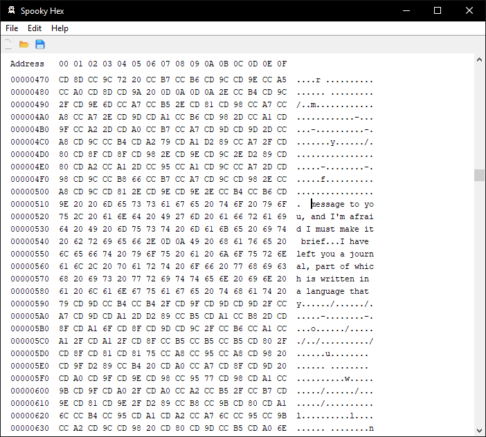

# Spooky Hex (shex) hex editor

C99/C++98 Win32/GTK+ 3 & 4-based hex editor with no external dependencies.

Released on spooky day. Not finished or ready for use yet.

## Planned Supported Platforms

- Windows
    - 2000, XP, Vista, 7, 8, 10, 11
    - 32-bit and 64-bit supported
    - Builds on Visual Studio 2008 or later and GCC &lt;idk because I haven't tested yet&gt;
    - TODO: not building yet for 2000/XP right now but takes minimal modifications to do so
        - Windows 2000/XP requires `wtk_open_file_dialog_show` to support the older dialogs
        - Windows 2000 requires `/subsystem:windows,5.00`
- Linux
    - Anything with GTK3 or GTK4 available
        - Ubuntu 12.04+ probably
    - Builds on GCC
    - TODO: a version of Linux WTK support exists but isn't included in this repo yet